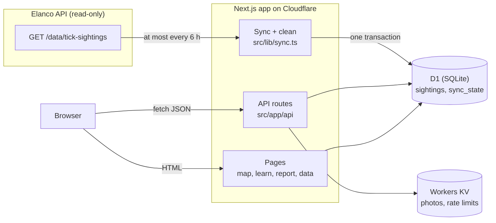

# Architecture

## Overview

The app keeps its own cleaned copy of the source data. Nothing a user does waits on Elanco's API, except the
very first request after the six-hour refresh window, and if that sync fails the previous copy is served.

## Layers

| Layer | Files | Job |
| --- | --- | --- |
| Source | `src/lib/source/client.ts` | Talk to Elanco's API: timeouts, retries, rate limits, shape checks |
| Cleaning | `src/lib/source/clean.ts`, `dates.ts`, `species.ts`, `src/lib/geo/places.ts` | Turn raw records into trusted ones, and report what changed |
| Storage | `src/lib/db/` | A four-method database interface (`all`, `first`, `run`, `batch`), the schema, and every query |
| Sync | `src/lib/sync.ts` | Decide when to refresh, and fall back to stored data |
| API | `src/app/api/**/route.ts` | Parse and validate input, call queries, return JSON or a consistent error |
| UI | `src/app/**/page.tsx`, `src/components/` | Server-rendered pages; the map, filters, charts and form are client components |

Each layer only calls the one below it. Route handlers stay thin: `parseFilters`, a query, `Response.json`.

## Decisions and trade-offs

**Copy the data instead of proxying the source.** Proxying would always show the latest data, but every page
view would spend the source's rate limit, inherit its outages, and run filters the source doesn't support
(it only filters by exact city or species). Copying costs up to six hours of staleness, which is fine for
sightings that are themselves days old.

**One table for source data and public reports.** A `source` column keeps them apart. Every query, filter and
insight then covers both without a `UNION`, and a sync can replace its own rows without touching reports.

**City-level locations.** The source gives a city name, not coordinates, so source sightings are mapped to
city centres and the map shows one marker per city. Public reports can include an exact point; it is stored
and drawn as its own dot, but still counts towards its city.

**Drop or keep?** A record is dropped only if it can't be placed on the map (no recognisable city), placed in
time (no valid date), or would double-count (duplicate). Everything else is fixed and kept, and an
unrecognised species becomes "Unknown species". Throwing away records that are mostly fine would bias the
counts.

**Typo correction that can say no.** City matching picks the single closest known name within one or two
edits, and returns nothing on a tie. A wrong guess would put a sighting in the wrong part of the country,
which is worse than leaving it out.

**A database interface instead of an ORM.** Four methods are enough. Production uses D1; tests run the same
SQL on Node's built-in SQLite, so queries are tested for real without a Cloudflare account.

**Warnings as well as errors.** Some report details are unlikely but possible: a tick seen in January, a map
point 80 km from the chosen city. Blocking those would lose real reports, so they are shown as warnings and
the person decides.

## Request lifecycle: loading the map

1. `GET /` renders on the server, reading species and years from D1 to build the filters.
2. In the browser, the map component fetches `/api/stats/cities?…filters`, plus public reports and the
   trend.
3. Each route parses its query with Zod. Bad input gets a 400 naming the field.
4. `readyContext()` makes sure the schema exists (once per instance) and calls `ensureFresh()`, which either
   returns at once or runs a sync.
5. Queries run with bound parameters, and the response carries `X-Data-Synced-At` and, during a source outage,
   `X-Data-Stale`.
6. Clicking a marker updates the URL (`?city=Leeds`), which triggers the city's sightings and timeline
   requests. The URL is also what Share sends.

## Wireframes

Low-fidelity sketches of the three main screens, showing the layout and the reasoning behind it:

- [Map, desktop](wireframes/map-desktop.svg)
- [City details, mobile](wireframes/city-mobile.svg)
- [Report form](wireframes/report-form.svg)
